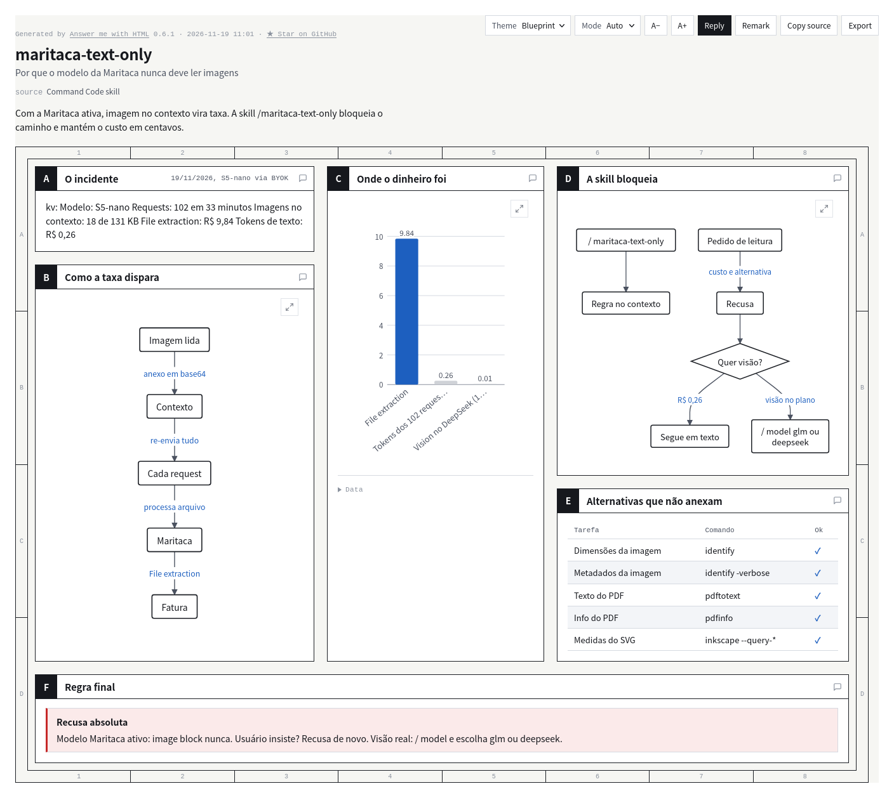

# maritaca-text-only



*Versão interativa: [docs/explainer.html](docs/explainer.html)*

Skill de blindagem de custo para o [Command Code](https://commandcode.ai) (padrão [Agent Skills](https://agentskills.io)): garante que, com um modelo da [Maritaca AI](https://maritaca.ai) ativo, **nenhum anexo visual entre no payload** — evitando a taxa de *File extraction* da API.

## O problema

Em novembro de 2026, uma sessão de trabalho com o modelo `s5-nano` (via BYOK) gerou:

| Métrica | Valor |
| --- | --- |
| Requests | 102 em ~33 minutos |
| File extraction | **R$ 9,84** (97% do gasto) |
| Tokens (1,5M input / 2,7M cacheados / 134K output) | R$ 0,26 |

A causa: a ferramenta de leitura de arquivos do agente anexa imagens (`read_file` em `.png`/`.jpg`) **inteiras como base64** ao contexto. O `s5-nano` é multimodal, então a imagem entra direto no payload — e a Maritaca cobra "File extraction" (~R$ 0,50/MB, inferido empiricamente) **re-cobrada a cada request** enquanto a imagem permanecer no histórico. 18 previews de ~131 KB re-enviados ao longo de 102 requests = R$ 9,84 em minutos.

Tokens de texto do S5-nano são quase de graça (R$ 0,10/0,60 por 1M). A taxa de arquivo é o único perigo.

## O que a skill faz

Quando invocada com `/maritaca-text-only`, injeta regras de comportamento no agente:

1. **Recusa absoluta** — nunca produz image block com modelo Maritaca ativo. Sem exceção, sem "só desta vez", mesmo com o usuário insistindo ou com `--yolo`
2. **Alternativas textuais** (verificadas na máquina do autor):

| Em vez de | Use |
| --- | --- |
| `read_file` em `.png .jpg .jpeg .gif .webp .bmp .tiff` | `identify` (dimensões), `identify -verbose` (metadados) |
| `pdftoppm` para renderizar PDF escaneado | `pdftotext`, `pdfinfo` — se sem camada de texto, informe e pare |
| Gerar preview e conferir visualmente | `inkscape --query-id=ID --query-width/--query-height`, validar XML, `pdfinfo` |
| OCR | `tesseract` (requer `sudo apt install tesseract-ocr`) |

3. **Contexto sujo** — se a conversa já tem imagens antigas, sugere `/clear` (cada request re-cobra tudo que está no histórico)
4. **Única via para visão real** — trocar de modelo (`/model` → `glm-5.3-flash` ou `deepseek/deepseek-v4.1-flash`), fazer a tarefa visual no plano Command Code e voltar

## Instalação

Requer [Command Code](https://commandcode.ai) (ou qualquer host compatível com Agent Skills).

```bash
git clone https://github.com/Wennington123/maritaca-text-only.git
mkdir -p ~/.commandcode/skills
cp -r maritaca-text-only ~/.commandcode/skills/
```

Ou, se preferir o escopo compartilhado entre ferramentas Agent Skills:

```bash
mkdir -p ~/.agents/skills
cp -r maritaca-text-only ~/.agents/skills/
```

Confirme que foi descoberta:

```bash
cmd skills list
```

## Uso

Digite `/maritaca-text-only` no início da sessão em que for usar um modelo Maritaca. A skill é `disable-model-invocation: true` — o agente nunca a carrega sozinho; **você** decide quando blindar.

Depois disso, qualquer tentativa de leitura visual recebe recusa + custo estimado + caminho alternativo.

## Configurações relacionadas

```bash
# Desligar o pipeline de visão por completo (nenhum modelo lê imagem):
cmd config set image-vision disabled --scope user

# Ou: um modelo "olhos" descreve imagens para o modelo de texto
# (só faz efeito em modelos TEXT-ONLY; multimodais como o S5 recebem a imagem direto):
cmd config set image-vision enabled --scope user
cmd config set feature-model:vision deepseek/deepseek-v4.1-flash --scope user
```

## Limitações honestas

- Skill é **instrução de comportamento**, não trava técnica no payload: o agente segue as regras, mas um LLM não é determinístico
- Modelos multimodais (S5, S5-nano) recebem imagem anexada **direto no payload** — o pipeline de descrição só intercepta para modelos text-only
- Trava 100% garantida: desabilitar o provider no `~/.commandcode/providers.json` (`"disabled": true`) enquanto não estiver usando
- A taxa de R$ 0,50/MB é **inferida empiricamente** (R$ 0,06 ÷ 131 KB no teste controlado), não documentada oficialmente pela Maritaca

## Segurança

A skill contém **nenhuma chave de API, credencial ou dado pessoal** — apenas regras de comportamento e comandos públicos. Review antes de instalar, como qualquer skill: skills são instruções executáveis no seu contexto de agente.

## Licença

[MIT](LICENSE)
